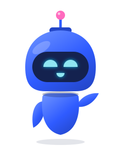
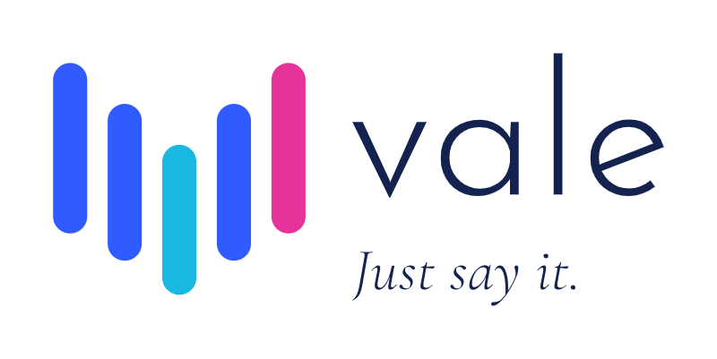
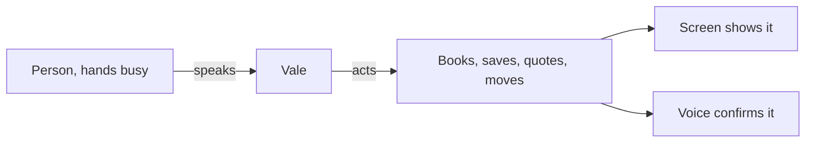
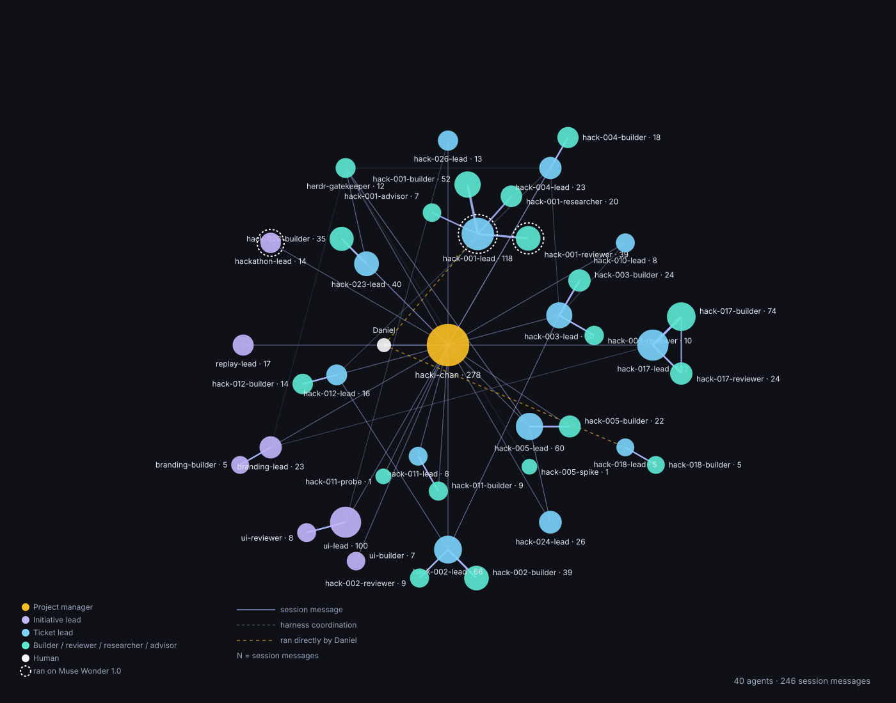

<div align="center">
  
  <br />
  <picture>
    <source media="(prefers-color-scheme: dark)" srcset="docs/img/logo-dark.png" />
    
  </picture>
  <p>Vale is a voice-first assistant with an intent-based interface for people who work with their hands: they say what they need, Vale does it, without stopping their work.</p>
  <p>
    
    
    
    
    
    
    <br />
    
    
    
    
    
    <br />
    
    
    
    <br />
    <a href="https://www.youtube.com/watch?v=eoWEdRfhTug"></a>
  </p>
</div>

We start with nail technicians: it is the domain we know first-hand, with a primary user there. The product is not limited to them.

Gloves on, gel curing, acetone in the air, the client in the chair asking how much. Stopping to type means losing the thread of the session.

Video: [Watch the 3-minute demo link](https://www.youtube.com/watch?v=eoWEdRfhTug).

## For judges

No key needed: this is the clearly labeled mock-data path. It plays the recorded run end to end, labeled “Replay: recorded run”:

```bash
npm install
cp .env.example .env
VALE_REPLAY=1 npm start
```

The empty `.env` is enough: no key needed.

With your own Meta key, run it live instead:

```bash
cp .env.example .env
# put your key in .env: META_API_KEY=...
npm run db:reset
npm start
```

Open the printed URL and tap the microphone. Setup details: [docs/setup.md](docs/setup.md).

## What it does

You ask by voice and Vale acts: it opens a session with a timer, saves a note about a client, adds to the shopping list, books or moves an appointment, prepares a quote and previews a nail design on the client photo. Prices and health notes appear on screen and are never read aloud. Everything is also available by touch, in eight screens: Agenda, Client files, Services, Supplies and stock, Shopping list, Payments, Goals and Preferences.

| User says | Vale does |
|---|---|
| “Starting a gel refill with David” | Opens the session and starts the clock (`session_open`) |
| “Note that David is allergic to latex” | Saves a private note on his record (`client_note_add`) |
| “Add primer to the shopping list” | Adds it to the list (`shopping_add`) |
| “How much does David pay?” | Quotes on a sheet; the totals stay on screen (`session_quote`) |
| “What do I have today?” | Reads the agenda (`agenda_show`) |
| “Move David to Friday” | Moves it at once with a notice; undo reverts it (`agenda_move_appointment`) |
| “Show her how it would look” | Previews the reference design on the before photo (`photo_preview_design`) |

If the mic is muted, the user can type instead. Language (EN | ES), voice engine and light or dark theme can be changed from the app.

Every name, price and note on screen is invented demo data.

## Meta models

| Model | Job in Vale | Runs on |
|---|---|---|
| Muse Spark 1.3 | The agent: decides and calls the business tools | Meta Model API |
| Muse Voice Transcribe 1.0 | Live speech input with turn detection | Meta Model API |
| Muse Image 1.0 | Design preview on the client photo | Meta Model API |
| SAM 3.1 | Counts five nails in the before photo, re-checks the preview, runs one more Image call on mismatch | Meta Model API |
| Muse Glimmer 30B (open weights, our deploy) | Private client briefs: what to say and show, never health text | Modal GPU (A10G, our deploy) |
| SeamlessM4T v2 Large (open weights, optional) | Spoken answers when configured | Modal GPU (T4, our deploy) |

## How it works

1. The person speaks, hands busy. Vale listens.
2. Vale acts: it books, saves, quotes and moves.
3. The screen shows what changed; the voice confirms it in one line.



*Diagram generated by a Muse Spark 1.3 agent.*

The Meta API key never leaves the server: the browser never talks to Meta directly.

**What happens between Vale, Meta and the screen?** [The answer, on screen.](docs/architecture.md)

## Open models, on our own GPU.

**A client history is the most private thing a small business has.** Vale summarizes it with an open-weights model we deploy and control ourselves.

- Muse Glimmer 30B writes each client brief before the appointment: what to say and what to show. Health notes never go in. It runs on our Modal GPU (A10G), quantized and with a speculative drafter, and scales to zero when idle.
- SeamlessM4T v2 gives Vale its spoken voice, on our GPU too. It is optional: without it, the browser voice speaks.

Every Glimmer call is logged with model, time and outcome, never the text.

[Deploy it yourself](docs/modal.md).

## Privacy

Vale is designed for PHI/PII minimization:

- Health-note text never reaches the cloud model. Only Glimmer reads it, on our Modal, with a token that lives in local `.env` or the shell, never in the repo.
- Glimmer never receives phone, email or birthday.
- A brief that repeats health words is dropped and generated once more. A second leak stores nothing.
- The health alert shows on screen only, never spoken. Amounts stay on screen too, never spoken.
- Logs keep the model, the time and the outcome, never the text.

## Limits

- All names, prices and notes are invented seed data. `npm run db:reset` restores them in seconds.
- Without `META_API_KEY` and without replay, the app says so on screen instead of starting voice.
- Without Glimmer or SeamlessM4T v2 Large configured, everything still works with the browser voice and plain cards.
- The photo preview needs a saved before photo and the appointment reference design.

## How we built it

**One developer, a team of agents, nine days.** Daniel set the direction; agents running on Meta Muse models wrote the specs, the code and the tests, as leads, builders and reviewers, coordinated by hacki-chan. [See how Vale was built](docs/how-we-built.md).



## License

Apache-2.0. See [LICENSE](LICENSE).

<div align="center">
  
  <p><em>Built for the hands that do the work.</em></p>
</div>
