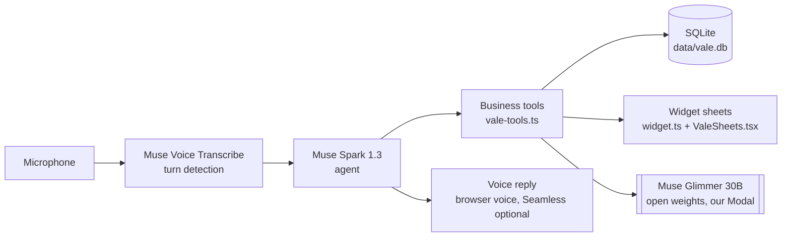

# Architecture

Voice in, sheets and voice out. One Next.js app; the agent and all tools run server-side.

## The loop

1. The mic streams to Muse Voice Transcribe (`src/lib/asr.ts`), which also detects turn ends. The wake word is “Vale”.
2. Each turn goes to Muse Spark 1.3 (`src/lib/agent.ts`) with the tool list. The agent books, saves, quotes and shows directly; only the quote and moves or deletes ask first.
3. Tools read and write SQLite (`src/lib/db.ts`, file `data/vale.db`, override with `VALE_DB_PATH`). Every write is logged; `undo_last` reverts the last one.
4. Tools return a widget kind; the screen renders the matching sheet (`src/lib/widget.ts` builds it, `src/components/ValeSheets.tsx` shows it): `shopping`, `low_stock`, `price`, `photos`, `client_card`, `goal`, and confirmations.
5. The reply is spoken with the browser voice, or Seamless when `SEAMLESS_URL` is set (`src/lib/speak.ts`, `src/app/api/seamless-voice/route.ts`).

## Tools

Defined in `src/lib/vale-tools.ts`:

- Sessions: `session_open`, `session_close`, `session_log_supply`, `session_quote`, `session_quote_accept`
- Clients: `client_create`, `client_card_show`, `client_summary`, `client_note_add`
- Agenda: `agenda_create_appointment`, `agenda_show`, `agenda_move_appointment`, `agenda_cancel_appointment`, `agenda_create_reminder`
- Stock and shopping: `stock_set`, `stock_add`, `shopping_show`, `shopping_add`, `shopping_remove`, `stock_show_low`
- Meta: `undo_last`, `widget_show`, `tool_get_details`
- Photos: `photo_preview_design`, `photo_show`

## Private briefs

Client records go only to Glimmer, the open-weights model on infrastructure we run (`src/lib/client-briefs.ts`, `modal/glimmer.py`). The cloud model sees the name and the agenda, never the health notes. `npm run db:reset` precomputes one brief per client; failures resolve to null and the cards open without them.

## Replay

`replay/demo-run.json` holds recorded turns: transcript, tool call, reply, widget and board, with health notes masked. `VALE_REPLAY=1` serves that file instead of the mic (`/api/replay`), and the screen plays it back labeled “Replay: recorded run”. Record a fresh run with `npm run replay:record`.
