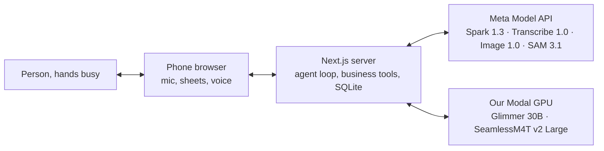

# Architecture

Voice in, sheets and voice out. One Next.js app; the agent and all tools run server-side.

Diagram generated by a Muse Spark 1.3 agent.

Health text crosses only into the Modal box. The Meta API key never leaves the server.

## The loop

1. The mic streams to Muse Voice Transcribe, which also detects turn ends. The wake word is “Vale”.
2. Each turn goes to Muse Spark 1.3 with the tool list. The agent books, saves, quotes and shows directly; moves and cancels act at once with a notice that `undo_last` reverts, and only the quote waits for acceptance.
3. Tools read and write SQLite. Every write is logged; `undo_last` reverts the last one.
4. Tools return a widget kind and the screen renders the matching sheet: shopping, low stock, price, photos, client card, goal, and confirmations.
5. The reply is spoken with the browser voice, or with SeamlessM4T v2 Large when its Modal endpoint is set.

## Tools

25 tools reach the model; screen-only actions (`manage_*`, `service_show`) stay internal. Every write is logged with its table and row; `undo_last` reads that log and reverts the newest entry.

| Group | Tools |
|---|---|
| Sessions | `session_open`, `session_close`, `session_log_supply`, `session_quote` |
| Clients | `client_create`, `client_card_show`, `client_summary`, `client_note_add` |
| Agenda | `agenda_create_appointment`, `agenda_show`, `agenda_move_appointment`, `agenda_cancel_appointment`, `agenda_complete_reminder`, `agenda_create_reminder` |
| Stock and shopping | `stock_set`, `shopping_show`, `shopping_add`, `shopping_remove`, `stock_show_low` |
| Photos | `photo_preview_design`, `photo_show` |
| Goals | `goal_show` |
| Control | `undo_last`, `widget_show`, `tool_get_details` |

## Private briefs

Client records go only to Glimmer, the open-weights model on our deploy. The cloud model sees the name and the agenda, never the health notes. Resetting the demo database precomputes one brief per client; failures resolve to null and the cards open without them.

## Replay

The demo run file holds recorded turns: transcript, tool call, reply, widget and board, with health notes masked. A replay flag serves that file instead of the mic, and the screen plays it back labeled “Replay: recorded run”. A record script folds fresh live turns into a new run file.

[TBD: this path becomes `npm run demo`, with a scene pill.]

## Code map

| Component | File |
|---|---|
| Agent loop | [src/lib/agent.ts](../src/lib/agent.ts) |
| Business tools | [src/lib/vale-tools.ts](../src/lib/vale-tools.ts) |
| Voice input and turn detection | [src/lib/asr.ts](../src/lib/asr.ts) |
| Database | [src/lib/db.ts](../src/lib/db.ts) |
| Widget kinds | [src/lib/widget.ts](../src/lib/widget.ts) |
| Screen sheets | [src/components/ValeSheets.tsx](../src/components/ValeSheets.tsx) |
| Voice reply | [src/lib/speak.ts](../src/lib/speak.ts), [src/app/api/seamless-voice/route.ts](../src/app/api/seamless-voice/route.ts) |
| Photo preview | [src/lib/photo-preview.ts](../src/lib/photo-preview.ts), [src/app/api/photo-preview/route.ts](../src/app/api/photo-preview/route.ts) |
| Nail segmentation | [src/lib/nails.ts](../src/lib/nails.ts) |
| Private briefs | [src/lib/client-briefs.ts](../src/lib/client-briefs.ts) |
| Replay player | [src/lib/replay.ts](../src/lib/replay.ts), [replay/demo-run.json](../replay/demo-run.json) |
| Modal backends | [modal/glimmer.py](../modal/glimmer.py), [modal/seamless.py](../modal/seamless.py) |
