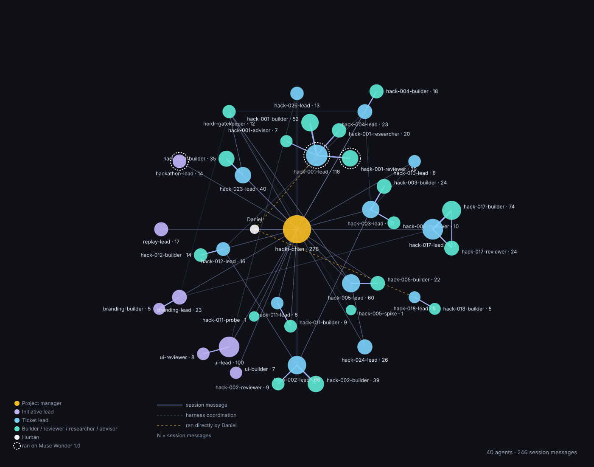

# How we built it

- All the code was written by Muse Code agents, each ticket in its own herdr workspace on Muse Spark 1.3: a lead writes spec and acceptance tests, a builder plans and codes, an optional reviewer checks the diff.
- Muse Wonder: planning, a few complex early tickets, reviewing and testing the workflow.
- Hacki-chan, a project-manager agent running on Hermes Agent, powered by Muse Spark 1.3, ran the ticket agents through the herdr CLI.
- Agents coordinated through Muse session messages, shown in the graph.
- Daniel approved every plan before any code was written and merged every PR.
- Exception: the brand identity (logo and design tokens) was turned into code by an external tool from visual references generated with Muse Image 1.0.

*Generated by a Muse Spark 1.3 agent from the Muse Code session logs.*
